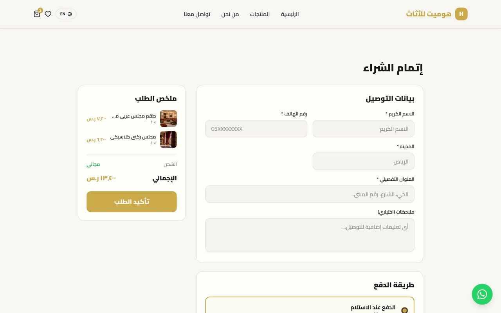
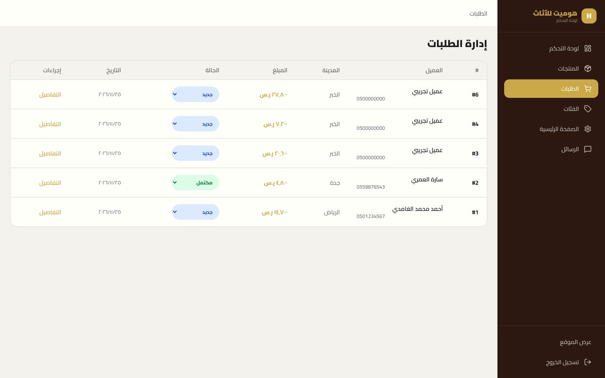
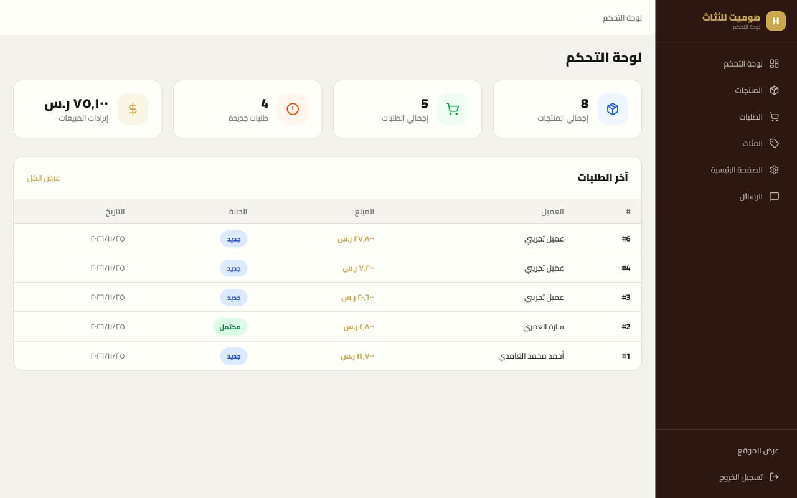

# Homeit Furniture — Bilingual E-commerce Store

A full-stack furniture store with an Arabic/English storefront (RTL and LTR) and an admin panel. The project is a pnpm monorepo: a React storefront, an Express API, a PostgreSQL schema, and an OpenAPI contract that the typed client and validators are generated from.

<p align="center">
  
  
</p>
<p align="center">
  
  
</p>
<p align="center">
  
  
</p>
<p align="center">
  
  
  
</p>

*Screenshots come from a local run with demo data.*

## Features
**Storefront**
- Arabic and English with a language switch. Layout direction (RTL/LTR) follows the language.
- Hero slider, catalogue search, category filter and sorting
- Product pages with discounts and stock status, a wishlist, and a cart
- Cash-on-delivery checkout and an order confirmation page
- Contact form, FAQ, returns policy and a WhatsApp button

**Admin panel**
- Dashboard with revenue, order and product statistics
- Product and category management, with image uploads checked by file content
- Order status workflow and customer messages
- Homepage content editing (hero slides, announcement bar)

## Tech stack
| Layer | Technology |
|---|---|
| Frontend | React 19, TypeScript, Vite 7, Tailwind CSS 4, TanStack Query, Wouter, Framer Motion |
| API | Express 5, JWT, bcrypt, Multer, Pino logging |
| Data | PostgreSQL, Drizzle ORM |
| Contract | OpenAPI spec, with the React Query client and Zod schemas generated by Orval |
| Tooling | pnpm workspaces, TypeScript project references, Node test runner |

## Architecture
```
artifacts/majalis-alraqi/   Storefront and admin SPA
artifacts/api-server/       Express API, auth, uploads
lib/api-spec/               OpenAPI contract and Orval codegen config
lib/api-client-react/       Generated typed React Query hooks
lib/api-zod/                Generated Zod validators
lib/db/                     Drizzle schema (products, categories, orders, order items, users, wishlist, messages, homepage settings)
scripts/                    Demo seed
tests/                      Unit tests for security boundaries and money handling
```
Orders accept only product IDs and quantities. The API prices each order from the database in integer hundredths and saves the order and its items in one transaction.

## Installation
Use Node.js 22 and pnpm 10 (the lockfile format is 9.0; pnpm 11 and later refuse the workspace's build-script settings).
```bash
npx pnpm@10 install --frozen-lockfile
```
Supply environment variables in the process environment. A root `.env` file is not automatically loaded by all workspace commands.

## Environment and local development
See `.env.example`. Set `DATABASE_URL` to a local database and generate a strong `SESSION_SECRET` (at least 32 characters; the API refuses to start with a missing or placeholder secret). `CORS_ORIGINS` lists allowed cross-origin frontends; when it is empty only same-origin requests are allowed. Behind a reverse proxy, set `TRUST_PROXY` to the number of proxy hops so the login limit counts real client addresses.

Demo data (development only; refuses to run with `NODE_ENV=production`):
```bash
SEED_ADMIN_EMAIL=you@example.com SEED_ADMIN_PASSWORD='a-unique-12+-character-password' pnpm --filter @workspace/scripts run seed
```
In a POSIX shell, with database and secret variables already exported:
```bash
pnpm --filter @workspace/db run push
PORT=3001 pnpm --filter @workspace/api-server run dev
```
In a second terminal:
```bash
PORT=5173 BASE_PATH=/ pnpm --filter @workspace/majalis-alraqi run dev
```
The current Vite configuration does not supply an API proxy. Configure a local reverse proxy for `/api`, or a deliberate API base URL, before testing full frontend/API flows.

## Validation and build
```bash
pnpm run typecheck
PORT=5173 BASE_PATH=/ pnpm run build
npm run test:security
```
Checked on 24 November 2026 (Node.js 22, pnpm 10, PostgreSQL 16, demo data only): a frozen-lockfile install, typecheck, build and 13 unit tests; and against the running API with a real database: order totals calculated from stored prices in integer hundredths (client-sent prices ignored), rejection of invalid, unknown and out-of-stock items, full rollback when inserting order items fails, the login limit (429 after 10 attempts), rejection of non-image uploads disguised as images, and refusal to start with a weak `SESSION_SECRET`. This was not a browser end-to-end or production test.

Known limits: the login limit is per process (not shared across replicas); logout removes the token on the client but does not revoke issued JWTs; upload checks identify the image container but do not fully decode images; upload URLs are relative (`/api/uploads/...`), so a frontend on a different domain needs a proxy or API base URL.

## API
Route modules cover authentication, categories, products, orders, contact, homepage, wishlist and uploads. Administrative routes require authorization. Order creation accepts only product IDs and integer quantities (1–100, up to 100 lines), reads prices from the database and saves the order and its items in one transaction.

## How this project was built
The first version was generated with **Replit Agent** from my written requirements. Many early commits are Agent checkpoints, such as "Published your App". I designed and directed the store and its admin features, then reviewed, debugged and hardened the code.

Hardening work since then, done with AI coding assistants and tested as described above:
- **Server-side order validation:** prices come from the database, and saving an order is transactional.
- **Startup secrets:** the API refuses to start with a weak `SESSION_SECRET`.
- **Seed data:** no default admin credentials, and the seed is disabled in production.
- **Access controls:** an explicit CORS allow-list and login rate limiting.
- **Uploads:** checked by file content, with generated file names.
- **Build and frontend fixes:** a passing typecheck, exact money arithmetic, bundled (self-hosted) storefront images instead of third-party hotlinks, and fixes to the mobile hero slider and the header and announcement layout.

## Roadmap
- Browser end-to-end tests in CI
- Revoking tokens on the server at logout
- A public demo deployment with demo data
